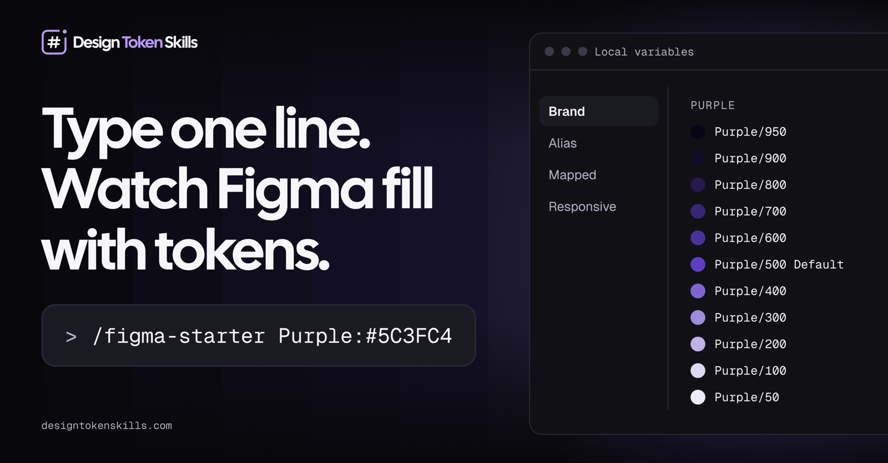

# Figma Design Tokens Starter Kit

[](https://github.com/manolobevia/design-tokens-starter-kit/actions/workflows/tests.yml)

Type one short line, get real **Figma variables and text styles** written to your open file. Twelve Claude Code skills build a complete token system (color, aliases, usage roles, spacing, radius, border width, motion and typography), a visual **Design Tokens** page that documents it, and code exports for developers.



## Quick start

One line builds the whole system: your brand colors, the system colors, aliases, Light and Dark usage, spacing, radius, border width, motion, typography and the Design Tokens page.

```
/figma-starter Plum:#3B1A53 Periwinkle:#8E7FAE heading "Moneta Sans" body Lato
```

The first color becomes Primary and the second Secondary (up to four: Tertiary, Accent). Fonts are optional and default to Inter and Roboto. Add `dry run` to see the plan first. Want to understand each step? The skills below do the same work one at a time.

**Fonts.** The heading and body fonts must be available in your Figma account (Google Fonts are). Figma checks this and refuses a name it cannot find, with the closest match. The code export only names the font (`"Playfair", sans-serif`); load it on your site yourself, for example with a Google Fonts link, or text falls back to `sans-serif`.

## How the tokens fit together

```
Brand  →  Alias  →  Mapped        Responsive
raw       roles     usage          type scale
values    (Primary) (Text/heading) (Desktop / Mobile)
```

Every Alias variable references a Brand variable. Every Mapped variable references an Alias variable. Nothing downstream holds a copied hex.

## The skills

| Skill | You type | It writes |
|---|---|---|
| `figma-color-scale` | `Purple:#5C3FC4` | An 11-step scale (950 to 50) in **Brand** |
| `figma-alias-bridge` | `Brand/Purple -> Alias/Primary (Purple)` | **Alias** group of references into Brand |
| `figma-mapped-roles` | `Mapped` | **Mapped** Surface, Border, Text and Icon variables referencing Alias |
| `figma-spacing` | `Spacing` | 4px-unit spacing scale in **Brand** |
| `figma-type-scale` | `Typography` | Font and weight variables in **Brand**, **Responsive** size variables, text styles |
| `figma-radius` | `Border radius` | Border-radius scale in **Brand** |
| `figma-border-width` | `Border width` | Border-weight scale in **Brand** |
| `figma-motion` | `Motion` | Duration (TIMING) and easing (EASING) variables in **Brand** |
| `figma-contrast-fix` | `Contrast fix` | A preview frame of failing text and border pairs with a passing fix; `apply` retargets **Mapped** variables |
| `figma-token-docs` | `Design Tokens` | A **Design Tokens** page in Figma showing the whole system |
| `figma-export-tokens` | `Export tokens` | `tokens.css`, `tokens.tokens.json` and `tailwind.theme.css` for developers |
| `figma-starter` | `/figma-starter Plum:#3B1A53 ...` | Runs all of the above in order from your brand colors and fonts |

Add `dry run` to any line to preview without writing.

## Build order

Run the skills in this order, because each tier references the one before it:

1. **`figma-color-scale`**: your brand and neutral colors, or `-default` for the system colors. Fills Brand.
2. **`figma-alias-bridge`**: map Brand groups into Alias roles.
3. **`figma-mapped-roles`**: build the usage tier on top of Alias.
4. **`figma-spacing`**, **`figma-radius`**, **`figma-border-width`**, **`figma-motion`** and **`figma-type-scale`**: the non-color primitives. These don't depend on the color steps, so run them any time after step 1.
5. **`figma-token-docs`**: builds the Design Tokens page. Run it last, and again whenever tokens change.
6. **`figma-contrast-fix`**: when the page shows failing contrast, preview a passing fix for each pair, then apply the ones you choose.
7. **`figma-export-tokens`**: writes the tokens as code files for developers. Run it whenever tokens change.

## Parameters

Every skill reads one typed line. These are all the forms each one accepts.

**Any skill:** add `dry run` or `preview` to report what would happen and write nothing. Type `-h` (for example `/figma-spacing -h`) to print that skill's usage.

### `figma-color-scale`

| Type | Result |
|---|---|
| `Purple:#5C3FC4` | Scale `Purple/950` to `Purple/50`. The hex is the 500 Default |
| `Name=#HEX`, `Name:HEX`, `Name:#ABC` | Also accepted (with or without `#`, 3 or 6 digits) |
| Several colors | One per line, or separated by spaces or commas |
| `-default` | Red (error), Blue (information), Orange (warning), Green (success), Gray, plus Foundation |
| `Foundation` | Only `Foundation/White` and `Foundation/Black` |
| `Foundation White:#FAFAF7 Black:#0B0B0D` | Your own white and/or black. Either one alone works |

`-default` can be combined with your own colors. A color you type wins over the preset one of the same name. All colors go in the `Brand` collection.

### `figma-alias-bridge`

| Type | Result |
|---|---|
| `Brand/Purple -> Alias/Primary` | Every `Purple` step becomes a reference in `Primary` |
| `... Alias/Primary (Purple)` | Text in parentheses is a note and is dropped from the name |
| Arrow | `->`, `→`, `=>` or the word `to` |
| Several lines | One bridge per line. Running again repoints, never duplicates |
| `-default` | Six bridges: Gray → Neutral (Neutral is always Gray), Red → Error, Green → Success, Orange → Warning, Blue → Information, Foundation → Foundation |

`-default` does not create Primary, Secondary and so on. Add those yourself, in the same message: `-default` plus `Brand/Purple -> Alias/Primary`. A line you type replaces the default for the same role. If a Brand group is missing, the skill names it and does not guess.

### `figma-mapped-roles`

| Type | Result |
|---|---|
| `Mapped` | Full preset: Surface, Border, Text, Icon (Light mode) |
| `Mapped/Text`, `Mapped/Icon` | Only those groups. Combine several in one message |
| `Mapped dark` | Add the Dark mode and fill it for everything that exists |
| `Mapped/Text dark` | Create the group and add Dark in one run |
| `Alias/Neutral/900 -> Mapped/Text/heading` | Point one variable at one Alias variable |
| `... -> Mapped/Text/action (dark)` | Same, for Dark only. `(light)` also works |
| `rename Surface/sucess to Surface/success` | Rename in place, bindings stay connected |
| `reset Mapped/Text` | Put hand-changed variables back to the preset |

Hand-tuned values are kept on later runs unless you `reset` or use an arrow line.

### `figma-spacing`

| Type | Result |
|---|---|
| `Spacing` or `Spacing scale` | The whole scale |
| `Spacing/4` | One step. Several can share a message |
| `reset Spacing`, `regenerate the spacing scale` | Overwrite hand-changed values |

Token = number of 4px units: `Spacing/4` is 16px. Steps: `0` (0px), `0-25` (1px), `0-5` (2px), `1` (4), `2` (8), `3` (12), `4` (16), `5` (20), `6` (24), `8` (32), `10` (40), `12` (48), `16` (64), `20` (80), `24` (96).

### `figma-export-tokens`

| Type | Result |
|---|---|
| `Export tokens` | `tokens.css`, `tokens.tokens.json` and `tailwind.theme.css` in `./tokens` |
| `Export tokens css`, `json`, `tailwind` | Only those files. Several can be combined |
| `Export tokens to src/styles` | Write to another folder |

Use them in code: `@import "./tokens/tokens.css";`, then set `data-theme="dark"` on `<html>` for Dark mode. For Tailwind v4, import `tailwindcss`, then `tokens.css`, then `tailwind.theme.css`. References stay references (`--alias-primary-500: var(--brand-plum-500)`), and the files are generated, so rebuild them instead of editing by hand.

### `figma-starter`

| Type | Result |
|---|---|
| `/figma-starter Plum:#3B1A53 Periwinkle:#8E7FAE heading "Moneta Sans" body Lato` | The whole system and the page |
| `Name:#HEX` (1 to 4) | Brand colors, in order: Primary, Secondary, Tertiary, Accent |
| `heading <font>`, `body <font>` | Font families. Defaults: Inter and Roboto. Quote names with spaces |
| `dry run` | Show the plan, write nothing |

It calls the other skills in order, so it is safe to repeat: steps that already exist are skipped.

### `figma-radius`

| Type | Result |
|---|---|
| `Border radius` | The whole scale |
| `Border radius/2` | One step. Several can share a message |
| `reset Border radius` | Overwrite hand-changed values |

Token = number of 4px units: `Border radius/2` is 8px. Steps: `0`, `0-5` (2px), `1` (4), `2` (8), `3` (12), `4` (16), `6` (24), `full` (9999, a pill or circle).

### `figma-border-width`

| Type | Result |
|---|---|
| `Border width` | The whole scale |
| `Border width/0-5` | One step. Several can share a message |
| `reset Border width` | Overwrite hand-changed values |

Steps: `0`, `0-25` (1px), `0-5` (2px), `1` (4px).

### `figma-motion`

| Type | Result |
|---|---|
| `Motion` | Durations and easing curves |
| `Motion/Duration`, `Motion/Easing` | One group |
| `reset Motion` | Overwrite hand-changed values |

Durations are Figma's native `TIMING` variables (XFast 250, Fast 500, Default 1000, Slow 1500, XSlow 2500 ms, stored in seconds as Figma requires) and easings are native `EASING` variables (Standard, Enter, Exit, Linear). `Export tokens` writes them as `1000ms` and `cubic-bezier(...)`.

### `figma-token-docs`

| Type | Result |
|---|---|
| `Design Tokens` | Build or refresh the whole page |

The page opens with a clickable Contents (a card per frame with a live stat, and a link back from every frame), a short How to use guide (a card per skill, like this README) a How names work frame (the naming rules and a short Do and Don't), and a Token health frame (what needs attention, with the fix to run), then shows Brand color scales, Alias roles, Mapped usage in Light and Dark, contrast checks, every text style in Desktop and Mobile, font families and weights, spacing, border radius and border width. Each section is its own frame on the page, so you can find, link to or copy one at a time. Everything is bound to your variables and styles, so rerun it after a token changes. Sections whose tokens don't exist yet show a one-line note.

### `figma-contrast-fix`

| Type | Result |
|---|---|
| `Contrast fix` | Preview: builds a **Contrast fixes (preview)** frame below the Contrast checks frame. Each failing pair is a row such as `Light · action-hover on default · 4.45:1, needs 4.5:1`, with a box in the current colors next to a box with a passing fix. Variables are not changed |
| `Contrast fix apply` | Applies every fix |
| `Contrast fix apply Text/action Border/error` | Applies the fix for those Mapped variables only |
| `Contrast fix apply dark` | Applies only the Dark mode (`light` works too) |
| `dry run` | With `apply`: lists the changes and writes nothing |

A fix is the closest step of the same Alias role that passes on every surface the variable is used on, so the color changes as little as possible. It points the Mapped variable at that step (a reference, never a hex) and never edits Brand or Alias. If no single step passes (for example white or dark text on a button's three states), it says so and changes nothing: change the surface instead. To undo a fix, use `reset Mapped/Text` (`figma-mapped-roles`). Rerun `Design Tokens` afterward to refresh the page.

### `figma-type-scale`

| Type | Result |
|---|---|
| `Typography` | Fonts, Responsive collection (Desktop and Mobile), variables and text styles, in one run |
| `Typography heading Playfair body Lato` | Same, with your own fonts. Either one can be given alone |
| `reset Responsive` | Recalculate the size variables |
| `reset type styles` | Rebind hand-changed styles to the preset |

`Typography` creates what is missing under **Brand**: `Font family/Heading` (Inter) and `Font family/Body` (Roboto), and `Font weight/Light`, `Regular`, `Medium`, `Bold`. A font variable that already exists is left alone unless you name a font.

Settings can follow `Typography` in any order. Anything omitted keeps its default:

| Setting | Default | Meaning |
|---|---|---|
| `base 18` | 16 | Body size in px |
| `ratio 1.333` | 1.25 | Desktop scale ratio. Names work too (`Perfect Fourth`) |
| `mobile 1.2` | 1.2 | Mobile scale ratio |
| `line height 1.2` | 1.2 | Line height multiplier |
| `body line height 1.5` | 1.2 | Line height for Body and Caption only |
| `spacing 0.5` | 0.5 | Paragraph spacing multiplier |
| `body spacing 1` | 0.5 | Paragraph spacing for Body and Caption only |
| `grid 4` | 4 | Sizes round to a multiple of this |

Example: `Typography base 18 ratio 1.333 mobile 1.2`. Settings are not stored, so repeat them on later runs.

## Setup

You need: [Claude Code](https://claude.com/claude-code), Figma Desktop, and the [Figma Console MCP](https://github.com/southleft/figma-console-mcp) with its Desktop Bridge plugin running. First time? [Connect Claude Code to Figma](docs/figma-console-setup.md) walks through the token, the server and the plugin. macOS and Linux only; Windows is not supported for now.

1. Clone this repo and open the folder in Claude Code. The skills in `.claude/skills/` load automatically.
2. Open your Figma file in Figma Desktop and start the Desktop Bridge plugin.
3. Run a skill (see below).

To use the skills in every project, not only this folder, install them globally:

```bash
./install.sh            # copy the skills to ~/.claude/skills
./install.sh --check    # show what would change, copy nothing
```

It only copies and never deletes. Run it again after you change a skill, then restart Claude Code.

### Faster runs: the script server

Each skill runs a JavaScript file inside Figma. Without help, Claude has to paste the whole file into the tool call (the Design Tokens page script is about 1000 lines). The script server removes that: Figma fetches the script from your machine instead, and Claude only sends a few lines saying which script and which settings.

```bash
python3 ~/.claude/skills/figma-starter/scripts/serve_scripts.py   # or .claude/skills/... in this repo
```

It listens on `localhost:9231` (a port the Desktop Bridge plugin is allowed to reach), is read only, and serves only `figma-*/scripts/*.js`. The skills use it automatically when it is running and fall back to pasting when it is not. A full `/figma-starter` run needs about a dozen short calls instead of thousands of lines. Figma runs what the server returns, so only run it from a folder you trust.

## Running a skill

Two ways, same result:

| Way | Example | When to use |
|---|---|---|
| **Type the line** | `Spacing` | Fastest. Claude matches the line to the right skill |
| **Slash command** | `/figma-spacing` | Forces that skill. Safer for short lines like `Mapped` or `Responsive` |

Parameters go after the skill name:

```
/figma-color-scale Purple:#5C3FC4
/figma-alias-bridge Brand/Purple -> Alias/Primary (Purple)
/figma-mapped-roles Mapped/Text dark
/figma-spacing Spacing/4
/figma-type-scale Typography base 18 ratio 1.333 mobile 1.2
```

With no parameters, the skill does its default run (`/figma-spacing` writes the whole scale). Add `dry run` to preview. Type `/` to see the installed skills.

## Try it

Run these in order (more in [examples/starter-session.md](examples/starter-session.md)):

```
/figma-color-scale Purple:#5C3FC4
/figma-color-scale -default
/figma-alias-bridge -default
Mapped
Spacing
Typography
```

Check the Variables panel in Figma. Each tier should show references, not hex values.

## Development

The color math, the code export and the Figma scripts have tests (standard library plus Node, no install):

```bash
python3 -m unittest discover tests
```

`tests/test_repo.py` checks that every skill has a name matching its folder and a description under 200 characters, and that every Figma script parses (this needs Node, and is skipped without it). GitHub runs all of these on every push (see `.github/workflows/tests.yml`).

`tests/test_figma_scripts.py` runs the real Figma scripts against a small fake of the Plugin API (`tests/figma_harness.js`): the spacing, radius, border width, motion and type scale values (the type scale is checked against the table in its `SKILL.md`, Desktop and Mobile), that Alias and Mapped hold references and never hex, that Dark mirrors Light, and that the script server's CONFIG overrides work. `tests/test_mapped_contrast.py` checks that the Mapped preset passes WCAG AA in Light and Dark with the default colors and with a very dark brand color.

`tests/test_color_scale.py` checks the 11-step scales against the reference values in `figma-color-scale/SKILL.md`, the input forms and the `-default` preset. `tests/test_build_tokens.py` checks the CSS, DTCG and Tailwind output, including references, Dark and Mobile modes and the seconds-to-milliseconds conversion for motion.

## License

[MIT](LICENSE). Use it, change it and share it, including in commercial work. Keep the copyright notice.

## Good to know

- A typed line is the whole request. The skills do not ask for confirmation, and they are safe to repeat.
- If Figma is not connected, the skill says what is missing and writes nothing.
- Full rules per skill are in each `SKILL.md`. Project conventions are in [CLAUDE.md](CLAUDE.md).
